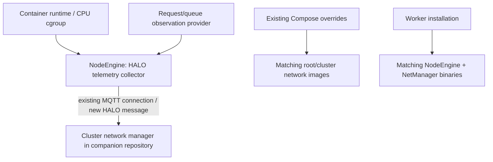

# High-level HALO support design for the core project

This plan integrates input production and deployment with this repository's components. Weight calculation is owned by the companion networking project. The implementation paths here concern NodeEngine, resource allocation, and deployment only.

## Data and deployment flow

A request-observation provider is not a ready component of this checkout. Its required contract is defined in the [low-level plan](skeleton-implementation-low-level.md). Integrate an actual application or gateway measurement source; TCP connections and UDP packets are not substitute request counters.

## Preserve the existing monitoring path

In [nodeengined.go](../go_node_engine/internal/daemon/nodeengined.go), NodeEngine registers with its cluster, connects to NetManager if overlay networking is enabled, and starts MQTT. It then reports node status and service resources on a `2s` cycle.

[StartServicesMonitoring](../go_node_engine/jobs/ServicesResourcesUpdater.go) runs `ResourceMonitoring` for active runtimes. [ReportServiceResources](../go_node_engine/mqtt/MqttClient.go) publishes the result on `nodes/<worker>/jobs/resources`. Keep this path for general lifecycle/resource monitoring.

The core cluster manager receives those reports in [clients/mqtt_client.py](../cluster_orchestrator/cluster-manager/src/cluster_manager/clients/mqtt_client.py). Its storage path transfers selected fields explicitly. Pydantic accepting extra fields does not guarantee that HALO fields survive the entire pipeline.

For minimal changes, deliver a dedicated HALO message over the same MQTT connection directly to the cluster network manager. Do not make `JobInstanceResources`, general resource storage, or the core manager's `15s` aggregate mandatory routing-telemetry hops.

## Proposed changes

| Component | Required work | Main location |
|---|---|---|
| Telemetry types | Window envelope, source and destination records | New `go_node_engine/model/HALOTelemetry.go` |
| Collector | Independent windows and request-provider integration | New `go_node_engine/jobs/HALOTelemetryCollector.go` |
| CPU source | Cumulative snapshots and effective containerd allocation | New `go_node_engine/virtualization/internal/containerd/HALOMetrics.go` |
| Runtime integration | Optional snapshot capability | Existing `RuntimeDispatcher.go` and runtime contracts |
| Allocation | Apply and verify CPU shares for HALO-managed containers | Existing `ContainersManagement.go` |
| Publication | New message using existing MQTT client | Existing `mqtt/MqttClient.go` |
| Startup/configuration | Enablement, window, and observation source | Existing `config/config.go` and `internal/daemon/nodeengined.go` |
| Deployment | Matching network-fork images and worker binaries | Existing overrides and worker installation process |

Keep the proposed types and observation-provider contract in those files. Do not add an independent monitoring service. Placement scheduling and its algorithm classes retain their existing responsibilities.

## Collector startup

Start one collector after worker identity is known, the runtime manager exists, and MQTT is ready. Reuse it for the daemon lifetime; do not instantiate a collector for each packet or request.

The proposed HALO configuration defaults to disabled. When enabled, use an independent default `5s` window, preserving the legacy `2s` monitoring loop. NetManager owns its separate ping schedule.

The first sample establishes counter baselines. Publish a valid delta only after two valid boundaries are available. A new container gets a new identity/baseline rather than inheriting the removed container's history.

## Reliable CPU allocation

The containerd deployment path must enforce a HALO-managed service's CPU allocation in OCI and read back the effective setting. An unchecked `Vcpus` value is not a valid $g$. Reserve host control resources before assigning the service CPU budget.

The model separates container allocations and does not add other services' loads to the cost function. Overcommit checks and competing-container tests are therefore part of model validity. Quota alone does not guarantee CPU supply on a saturated host.

Only runtimes with a valid measurement capability provide HALO capacity inputs. Do not assume automatic container-model support for unikernel or crosvm. Unsupported capabilities produce an unavailable status; adding an obligatory interface method must not break existing runtime paths.

## Request and queue observations

The observation provider identifies attempt starts/outcomes at the source and arrivals, service starts, and processing completions at the destination. An existing application or gateway tool may supply it, provided it satisfies the identity and window contract.

NodeEngine reads or aggregates the observations; success and application-error definitions remain explicit in the provider configuration. Version those definitions and do not treat incompatible populations as the same metric.

Missing queue observations are permitted and marked unavailable. Missing completed-processing counts do not support a new capacity estimate. Request duration minus ping, or flow count, cannot fill those gaps.

## Delivery to the cluster network manager

Publish `nodes/<worker>/halo/telemetry` through `publishToBroker("halo/telemetry", payload)`. The existing function supplies the `nodes/<worker>/` prefix. No second MQTT client or port is required.

The companion cluster network manager subscribes to this new topic. The core cluster manager does not need to receive or republish it. CPU and queue details go to the owning cluster network manager, not raw to the root.

During MQTT interruption, publication queues must remain bounded. Preserve the window and message identity; retrying a message retains that identity. Late delivery does not make observations fresh, and QoS1 does not provide exactly-once processing.

## Deploying the two repositories together

This project's Compose files run `root_service_manager` and `cluster_service_manager` from external images. The inspected implementation in the companion checkout is Python; stale language labels in contextual documentation do not override its Dockerfiles.

Use the existing `override-local-service-manager.yml` files to select local images built from this network fork. Building an image does not replace an already running container. The managers retain `python service_manager.py` as their image startup command.

Current Compose uses network-root port `10099` and network-cluster port `10110`. The root Dockerfile's default may differ; deployed Compose settings determine connectivity. Host networking also requires reachable addresses under the corresponding override.

The current worker installer downloads official NodeEngine and NetManager releases. Using it without selecting this fork's artifacts can overwrite HALO binaries. Record the versions of both binaries and both manager images in each experiment.

## Restart and missing-data behavior

After restart, the collector baselines the current counters. An incomplete window must not become a definite rate or capacity. The network manager owns reuse of a valid compatible capacity estimate or startup calibration; NodeEngine does not invent emergency weights.

If the observation provider fails, mark the affected measurements unavailable with a reason. No traffic is different from no measurement source. Idle containers still report identity/readiness so that presence does not depend on traffic.

## Implementation and acceptance order

1. Verify typed measurements and the observation-provider contract using known identities, clocks, and counters.
2. Verify CPU enforcement and whole-cgroup counter deltas for the container runtime.
3. Start the independent collector and publish to MQTT, preserving legacy behavior when HALO is disabled.
4. Confirm the companion manager receives the data and reproduces the thesis example from those inputs.
5. Deploy matching images/binaries and test direct user entry separately from the request-versus-flow limitation.

The [low-level plan](skeleton-implementation-low-level.md) lists exact changes and acceptance criteria. These are future steps, not reported runtime results.
